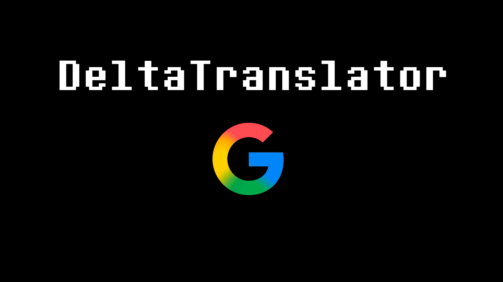

[English](../README.md) · [Русский](README.ru.md) · [Español](README.es.md) · [Português (Brasil)](README.pt-BR.md) · [Deutsch](README.de.md) · [Polski](README.pl.md) · [Українська](README.uk.md) · **Türkçe** · [Italiano](README.it.md) · [Français](README.fr.md)

# DeltaTranslator

DeltaTranslator, DELTARUNE'un özgün metninin üzerinde makine çevirisi gösteren gayriresmî bir moddur. Hedef diller: **Rusça, İspanyolca, Brezilya Portekizcesi (`pt`), Almanca, Lehçe, Ukraynaca, Türkçe, İtalyanca ve Fransızca**. Windows kurucusu İngilizce, Rusça, İspanyolca, Brezilya Portekizcesi ve Almanca arayüz sunar. İngilizce oyun içi çeviri hedefi değildir.

## Neleri çevirir?

Desteklenen keşif ve savaş diyaloglarını, yanıt seçeneklerini, `obj_writer` veya `obj_menuwriter` tarafından yazılan menü metinlerini ve 5. bölümdekiler dahil `obj_talkbubble` konuşma balonlarını çevirir. Çeviri ilgili balonla birlikte hareket eder. Görsellere gömülü diğer metinler, desteklenmeyen kodlarla çizilen yazılar ve ritim oyunlarının şarkı sözleri çevrilmez. Oyunun özgün metni ve yazı tipleri değişmez.

Kısa repliklerin ve Tenna’nın konuşma balonlarının çevirisi özgün metnin yanında görünür. **Lovely** gibi bilinen animasyonlu yazılar ayrı bir altyazı olmadan diyalog içinde çevrilir.

## Çalışma biçimi ve gizlilik

Mod, desteklenen metni ve hedef dili HTTPS üzerinden Google Çeviri'ye gönderir. Kaynak dil otomatik algılanır. İnternet gerekir. Otomatik çeviri varsayılan olarak kapalıdır; bu durumda yalnızca F5'e basıldığında istek gönderilir. Sonuç ayrı bir katmanda gösterilir. Bu mod, resmî yerelleştirme veya bir Google projesi değildir.

- **F1:** dil seçiciyi aç veya kapat; ok tuşları ve **Enter** ile seç ya da doğrudan **1–9** tuşlarından birine bas.
- **F2:** desteklenen yerlerde otomatik konumlandırmayı aç veya kapat.
- **F3:** otomatik çeviriyi aç veya kapat.
- **F5:** desteklenen güncel metni çevir. **F6:** çeviriyi gizle.

Oyun içi cihaz menüsü kısayolları ve otomatik modları gösterir. Rusça çeviri katmanında **DubstepDude** tarafından uyarlanan Determination Mono kullanılır. [Yazı tipi kaynakları ve katkıda bulunanlar](../Fonts/Overlay/README.md).

## İndirme ve kurulum

Sisteminize uygun kurucuyu [Releases](https://github.com/portalT4/DeltaTranslator/releases) sayfasındaki **Assets** bölümünden indirin. Önce DELTARUNE'u kapatın.

- **Windows x64:** `DeltaTranslator-Setup-win-x64.exe` dosyasını çalıştırın.
- **Linux x64 / Steam Deck (Proton):** `DeltaTranslator-Setup-linux-x64.AppImage` dosyasını dosya yöneticisinden açın (Deck'te Masaüstü Modu). Gerekirse dosya özelliklerinden çalıştırma izni verin. Sistem AppImage çalıştırabilmelidir.
- **macOS:** `DeltaTranslator-Setup-osx-arm64.zip` (Apple Silicon) veya `DeltaTranslator-Setup-osx-x64.zip` (Intel) dosyasını çıkarın ve Finder'da `DeltaTranslator.app` uygulamasını açın. Kurucu Apple tarafından noter onayından geçirilmemiştir. İmzalı oyunun kaynaklarını değiştirmek açılmasını engelleyebilir. Kurucu onay ister ve oyunu yeniden imzalamaz.

Mac veya Linux bilgisayarım yok; bu sürümlerde sorunlar olabilir. Oyun klasörünü seçin (Steam → Özellikler → Yüklü Dosyalar → Göz At), istediğiniz bölümleri işaretleyin ve **Install** düğmesine basın. Terminal veya ayrı bir .NET kurulumu gerekmez.

## Uyumluluk, güncelleme ve kaldırma

Kurucu oyun dosyalarını indirmez veya kayıtları değiştirmez. `.deltatranslator.bak` veya `.deltatranslator.<SHA-256>.bak` yedekleri oluşturur. Modu güncellemek veya kaldırmak için aynı oyun sürümünün özgün arşivlerini geri yükleyin ya da Steam'den oyun dosyalarını doğrulayın. Mac'te geri yüklerken eklenen yedekleri `.app` paketinin dışına taşıyın. Tek ortak arşivli eski bağımsız demolar, mobil portlar ve konsollar desteklenmez.

[Screenshots](../Screenshots/) · [Development](DEVELOPMENT.md)
